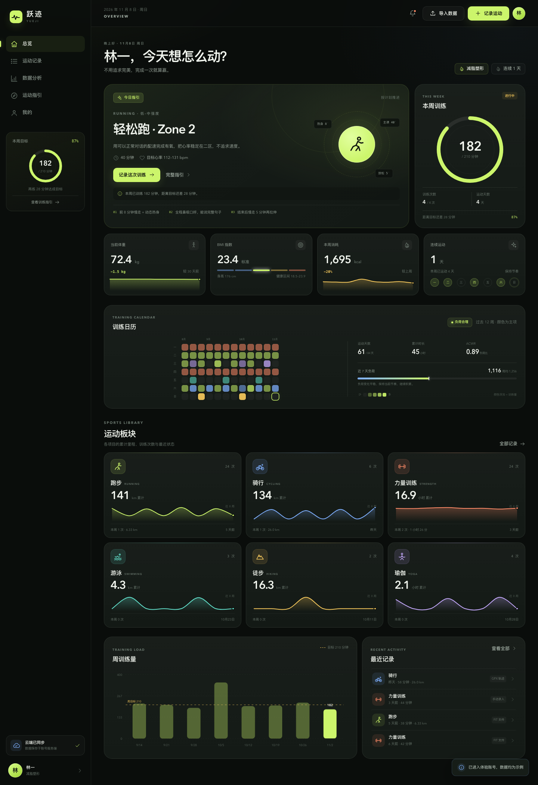
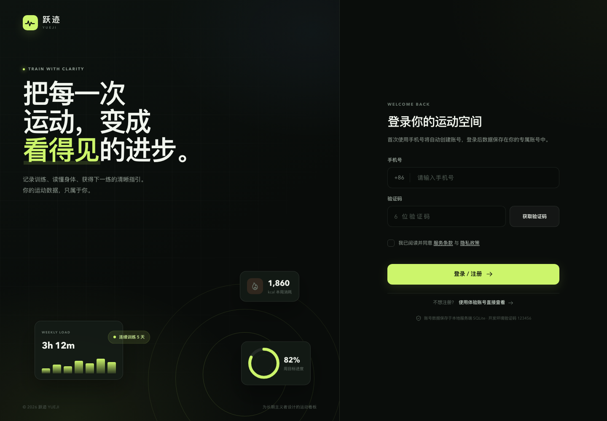
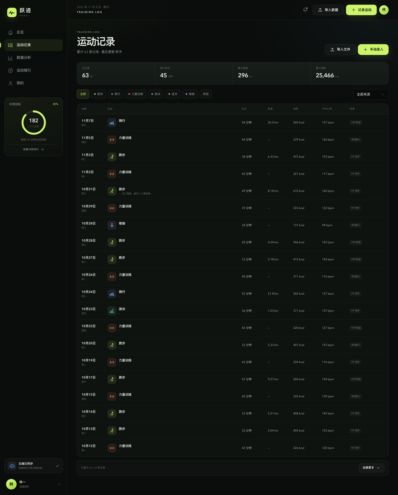
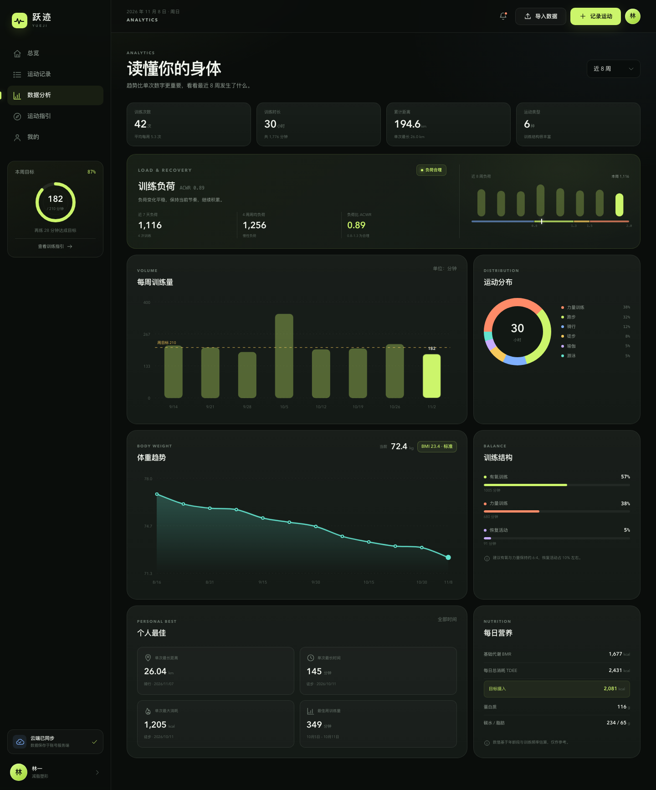
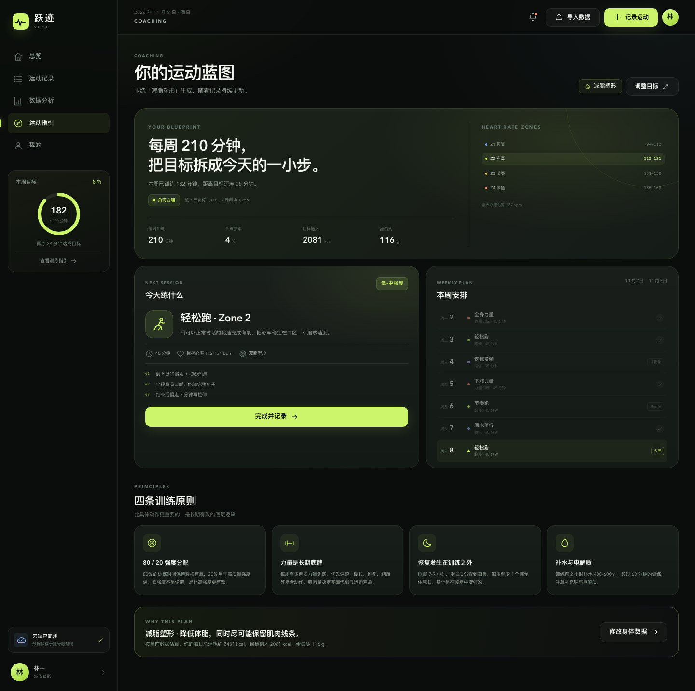
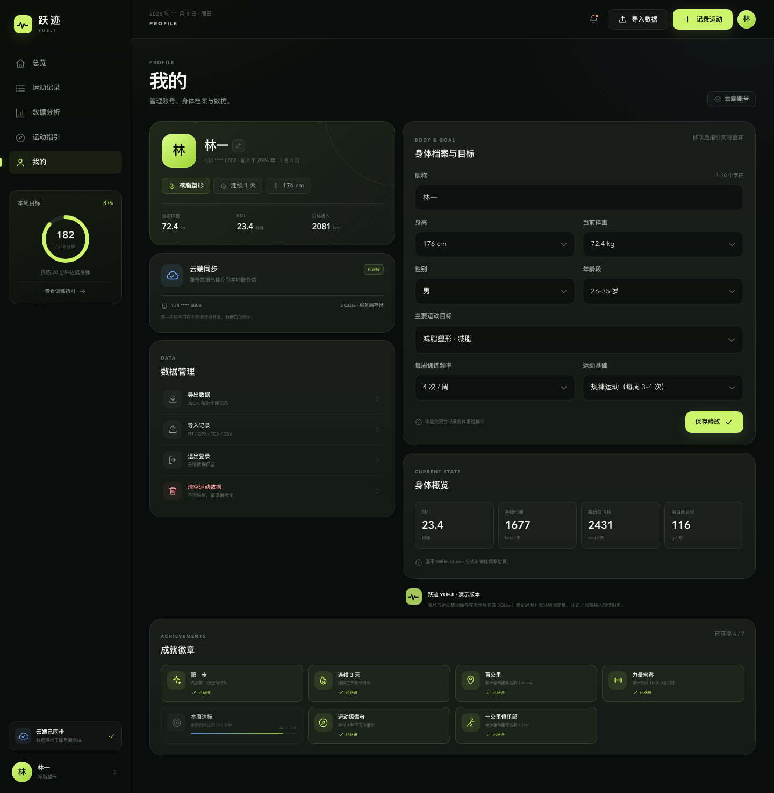
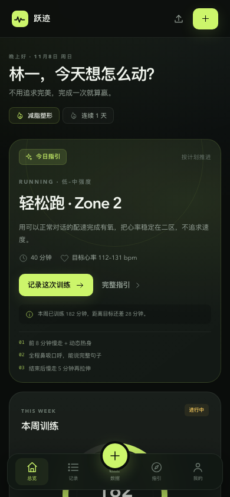
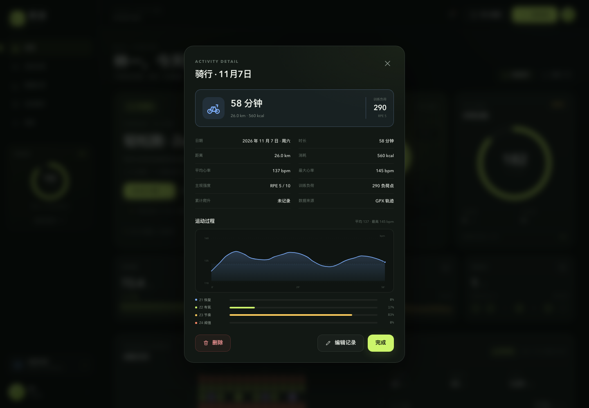

# 跃迹 YUEJI · 运动看板

一个运动记录看板：记录跑步、骑行、力量、游泳、徒步、瑜伽等训练，结合身高、体重、目标和训练过程，生成看板、负荷分析、趋势和下一练建议。

支持三种运行方式：本地 Python/SQLite、GitHub Pages 无登录本机版、GitHub Pages + Supabase 账号版。



## 运行模式

项目支持三种模式，共用同一套前端：

| 模式 | 后端 | 适用 |
| --- | --- | --- |
| `local` | 本仓库 `server.py` + SQLite | 本地开发、单机使用 |
| `browser` | 无后端，数据存浏览器 localStorage | **直接发布到 GitHub Pages，无需登录** |
| `supabase` | Supabase Auth + Postgres | 需要账号同步的多用户版本 |

模式由 [`js/config.js`](js/config.js) 控制：

```js
window.YUEJI_CONFIG = {
  mode: 'browser',            // 'local' | 'browser' | 'supabase'
  supabaseUrl: '',
  supabaseAnonKey: '',
  phoneEmailDomain: 'phone.yueji.app'
};
```

### 直接发布：GitHub Pages + 无登录本机版（默认）

- 不需要 Supabase、不需要手机号、不需要密码、不需要任何 Secrets。
- 每个访客的数据只保存在自己的浏览器里，互不共享。
- 支持首次引导、手动记录、FIT/GPX/TCX 导入、示例数据、JSON 导出备份。
- 部署工作流：[`.github/workflows/pages.yml`](.github/workflows/pages.yml)
- 工作流默认生成 `mode: 'browser'` 的 `dist/js/config.js`，只发布前端文件。

**最快发布（不用 Actions、不用 Secrets）**：

1. 新建一个公开 GitHub 仓库；
2. 把 `yueji-pages.zip` 解压到仓库根目录；
3. Settings → Pages → Source 选择 **Deploy from a branch**；
4. 分支选 `main`，目录选 `/ (root)`，保存。

稍等即可得到 `https://<用户名>.github.io/<仓库名>/`，打开后直接进入首次引导，不需要用户名和密码。

> `yueji-pages.zip` 是构建好的静态包，只包含前端文件。

> 换设备、换浏览器或清理浏览器数据后不会自动同步；请用「导出数据」备份。

### 可选：GitHub Pages + Supabase 账号版

- 手机号作为登录名，Supabase Email/Password Auth（内部映射 email，不发短信）
- 数据存 Supabase Postgres，带 RLS
- 互动榜需要额外执行 [`supabase/migrations/20261110_social.sql`](supabase/migrations/20261110_social.sql)
- 完整步骤：[`supabase/README.md`](supabase/README.md)
- 在 GitHub Actions 添加 `SUPABASE_URL`、`SUPABASE_ANON_KEY` Secrets，并设置仓库变量 `YUEJI_MODE=supabase`，工作流会生成对应配置。

## 电脑数据迁移到手机

无登录本机版不会自动跨设备同步；用 JSON 备份手动迁移：

1. 先把网页发布到 GitHub Pages / Netlify，手机能打开同一个网址。
2. 电脑打开「我的 → 数据管理 → 导出数据」，得到 JSON 备份。
3. 通过 AirDrop、微信文件传输助手、邮件或 USB 把 JSON 发到手机。
4. 手机打开同一网址，完成首次引导。
5. 手机进入「我的 → 导入记录」，选择该 JSON。

备份包含运动记录、心率/GPS 采样、力量明细、RPE、体重记录、昵称和身体档案；导入时会跳过重复记录，并恢复档案。导入是复制，不会让两台设备之后自动同步。

如果需要电脑和手机之后自动同步，需要使用 Supabase 账号模式（同一手机号 + 密码登录）。

## 快速运行

### 无登录本机版（默认）

直接打开静态页面即可，不需要 Python 后端：

```bash
cd default-workspace
python3 -m http.server 8080
```

打开 <http://127.0.0.1:8080>，会直接进入首次引导，不需要手机号或密码。

### 本地 Python/SQLite 模式

```bash
cd default-workspace
python3 server.py
```

打开 <http://127.0.0.1:8080/?mode=local>，可使用原来的手机号验证码登录和 SQLite 数据。

### Supabase 模式

把 `js/config.js` 的 `mode` 改为 `supabase` 并填入项目 URL/anon key，详见 [`supabase/README.md`](supabase/README.md)。

本地后端首次启动会自动：

- 创建 `data/yueji.db`；
- 写入体验账号与 12 周示例数据；
- 启动静态页面和 `/api` 接口。

重置本地数据（会删除所有账号与记录，并重新生成体验账号）：

```bash
rm -f data/yueji.db data/yueji.db-wal data/yueji.db-shm
python3 server.py
```

> 这是本地单体服务，前端和 API 使用同一域名，因此 Cookie、登录态和 API 调用都不需要额外配置 CORS。

### 环境变量

```bash
# 生产环境建议设置
YUEJI_SECRET='换成一串足够长的随机字符串' \
YUEJI_SECURE_COOKIE=1 \
python3 server.py
```

- `YUEJI_SECRET`：Session / 验证码哈希密钥；生产必须修改。
- `YUEJI_SECURE_COOKIE=1`：HTTPS 环境启用 Secure Cookie。
- `YUEJI_PORT`、`YUEJI_HOST`、`YUEJI_DB_PATH`：端口、监听地址、数据库路径。
- `YUEJI_DEV_CODE`：本地开发验证码，默认 `123456`。

## 体验账号

- 登录页点击 **「使用体验账号直接查看」**。
- 或手动输入手机号 `13800008888`，开发环境验证码 `123456`。
- 任意合法的 11 位手机号都可以注册新账号；首次登录后进入身体档案引导。

> 验证码目前是本地开发固定值 `123456`，并在页面上显示。正式上线必须接入短信服务并关闭这个开发开关。

## 当前账号与数据同步

- **真实账号**：手机号验证码登录，用户记录写入 SQLite；服务端使用 HttpOnly Session Cookie 维持登录态。
- **跨浏览器登录**：同一手机号在另一浏览器登录后，会拉取同一份服务端数据。
- **不再使用 localStorage 保存业务数据**：刷新页面、关闭浏览器后重新打开，登录态和数据仍来自服务端。
- **开发验证码**：`123456`，只用于本地环境。
- **微信登录**：本轮暂时关闭，界面不展示微信入口；后续接入微信开放平台/公众号/小程序时再单独实现 OAuth。

## 已实现的功能

### 1. 手机号登录与首次引导

- 手机号 + 验证码登录，首次登录自动创建账号。
- 登录前必须勾选服务条款；前后端均有校验。
- 两步式引导：身体数据 → 运动目标；可自定义昵称。
- **全部使用下拉列表**：
  - 性别、年龄段、身高（140–210 cm）、体重（35–150 kg，0.5 kg 步进）；
  - 运动目标（减脂塑形、增肌增力、提升耐力、保持健康、改善体态、缓解压力）；
  - 每周训练频率、当前运动基础。
  - 昵称（默认带手机尾号，可改为任意 1–20 个字符）。
- 右侧实时预览 BMI、每周训练目标、建议摄入热量、蛋白质目标。
- 完成引导后，档案和初始体重写入服务端，立即生成专属运动指引。

### 2. 运动看板

- **今日指引**：根据目标、本周训练量、距上次训练天数与训练负荷，动态推荐下一次训练；含训练内容、心率区间、时长和注意事项。
- **本周训练环**：周训练分钟数 / 目标、训练次数、运动天数、完成率。
- **身体指标**：当前体重与 30 天变化、BMI 分级、本周消耗、连续运动天数。
- **训练日历**：过去 12 周热力图，颜色代表主要运动、深浅代表训练量；点击日期查看当天记录，也可补录。
- **训练负荷**：根据近 7 天 / 4 周负荷计算 ACWR，提示负荷合理、偏高或过高，并影响当日指引。
- **运动板块**：跑步、骑行、力量、游泳、徒步、瑜伽六个板块，突出：
  - 累计距离 / 累计时长；
  - 总训练次数；
  - 近 8 周趋势迷你图；
  - 本周数据与最近一次时间；
  - 点击进入项目详情：总览、8 周趋势、最佳单次、历史记录，并可跳转到该项目全部记录。
- **最近记录**、**周训练量柱状图**。
- 每条记录可查看详情、编辑、删除；详情页展示心率过程曲线、心率区间分布，以及设备 GPS 生成的轨迹图。
- 力量训练支持动作明细：动作名称、训练部位、组数、每组次数和重量，自动计算训练容量；数据分析中增加按部位统计的组数/容量分布。
- 自动跟随手机系统的浅色/深色模式，统一柔和深色与浅色两套配色。
- 移动端精简为 5 个主入口，隐藏与数据页重复的概览模块，周目标改为紧凑进度。
- 单条训练可生成分享文案，支持系统分享或复制到剪贴板（不包含 GPS、备注等隐私内容）。
- Supabase 模式下提供训练互动榜：按本周训练时长/负荷排名，可点赞、留言；可关闭自己的排行榜参与。
- 有 GPS 的记录支持导出 GPX，可导入 Strava、Garmin、OSM 等平台继续查看。
- 轨迹图可点击「地图底图」加载 OpenStreetMap，查看真实地图环境；不点击时只显示本地轨迹。

### 3. 运动记录页

- 全部记录表格，支持按运动类型、数据来源筛选。
- 汇总条：总记录、累计时长、累计距离、累计消耗。
- 分页加载：首次显示 20 条，可继续加载。
- 每条记录展示日期、时长、距离、消耗、平均心率、来源。
- 手动录入与文件导入入口；支持编辑记录、修改 RPE 与训练负荷。
- 手动录入增加主观强度 RPE（1–10），实时计算训练负荷。
- 力量训练可添加多个动作，每个动作记录部位、组数、次数与重量；训练容量 = 组数 × 次数 × 重量。

### 4. 数据分析

- 近 8 周 / 近 12 周切换。
- 训练次数、时长、距离、类型数量汇总。
- 训练负荷横幅：近 7 天负荷、4 周周均负荷、ACWR 与负荷区间。
- 每周训练量柱状图（含目标线）。
- 运动类型分布环形图。
- 体重趋势折线图（基于体重记录）。
- 训练结构：有氧 / 力量 / 恢复占比与建议。
- 个人最佳：最长距离、最长时间、最大单次消耗、最佳周训练量。
- 营养估算：BMR、TDEE、目标摄入、蛋白质、碳水 / 脂肪。

### 5. 运动指引

- 根据目标与近期负荷输出每周训练蓝图、心率区间、训练频率、热量与蛋白质目标。
- 近期负荷过高时自动切换为恢复建议。
- 「今天练什么」：训练类型、描述、时长、心率区间、执行步骤，一键记录。
- 本周 7 天安排：区分已完成、未记录、今天；今天会根据当前状态动态覆盖为推荐训练。
- 四条长期训练原则。
- 可跳转到「我的」调整身体数据与目标，保存后立即重算。

### 6. 手动导入与文件上传

- 手动录入：运动类型、日期、时长、距离、消耗、平均心率、RPE、备注；消耗留空时按 MET 自动估算。
- 文件在浏览器本地解析，解析结果通过 API 写入服务端；FIT / GPX / TCX 会保留心率与 GPS 采样，用于运动过程曲线和轨迹图：
  - **FIT**：解析会话 / 圈 / 记录消息，支持心率、距离、时长、卡路里、爬升、压缩时间戳、带 endian flag 的 base type，以及 developer fields 的正确跳过（Zepp/Amazfit 常见）；力量训练无距离时也能按 session 时长导入。
  - **GPX**：从轨迹点计算距离、时长、爬升、平均心率，并按 `<type>` / 文件名推断运动类型。
  - **TCX**：读取 Lap 的时长、距离、卡路里、心率与轨迹采样。
  - **CSV**：支持中文 / 英文表头、逗号 / 分号 / 制表符，可一次导入多条；内置模板下载。
  - **JSON**：支持跃迹导出的备份文件，也支持 `activities` 数组；可同时恢复体重记录。
- 导入前展示解析摘要与预览；服务端按「日期 + 类型 + 时长 + 距离」去重。
- 示例文件在 [`sample-data/`](sample-data/)：
  - `demo-run.fit`
  - `demo-hike.gpx`
  - `demo-ride.tcx`
  - `demo-records.csv`

### 7. 我的 / 数据管理

- 账号概览、云端同步状态；昵称可在「我的」中随时修改（1–20 个字符）。
- Supabase 模式下「我的 → 账号安全」支持验证当前密码后修改登录密码。
- Supabase 模式下「我的 → 账号安全」支持验证当前密码后修改登录密码。
- 身高、体重、性别、年龄段、目标、频率、运动基础修改。
- 支持单独记录体重：选择日期、输入 0.1 kg 精度的体重；同一天重复记录会覆盖当天数据。
- 总览体重卡、数据分析体重卡和账号卡片都有「记录体重」入口；最新一条体重会同步为当前体重并写入趋势。
- 成就徽章：第一次记录、连续训练、百公里、力量常客、本周达标、运动探索者、十公里俱乐部。
- 从服务端导出全部数据为 JSON。
- 导入记录、退出登录、清空运动与体重数据。
- 支持空账号载入 12 周示例数据（服务端复制示例并换算到当前体重）。

## 账号与数据设计

### 登录流程

1. `POST /api/auth/send-code`：校验手机号，生成验证码并保存哈希（开发环境固定 123456）。
2. `POST /api/auth/login`：校验验证码，创建或查找用户。
3. 服务端创建 Session，返回 `HttpOnly` Cookie。
4. 前端通过 `GET /api/bootstrap` 拉取用户、档案、运动记录和体重记录。
5. 刷新页面时，Session Cookie 仍然有效，直接恢复登录态。

### API

```text
POST   /api/auth/send-code
POST   /api/auth/login
POST   /api/auth/demo
POST   /api/auth/logout
GET    /api/bootstrap
PUT    /api/profile        # 档案 + 昵称
POST   /api/activities
PATCH  /api/activities/:id
DELETE /api/activities/:id
POST   /api/activities/bulk
POST   /api/weights          # 记录体重，更新当前体重
POST   /api/demo/load
DELETE /api/data
GET    /api/export
GET    /api/health
```

力量记录额外接受 `strength` 数组：

```json
[
  { "name": "卧推", "part": "chest", "sets": 4, "reps": 8, "weight": 60 }
]
```

部位键：`chest/back/shoulders/arms/legs/glutes/core/full`。数据存储在 `activities.strength_json`，更新记录时一并提交。

Supabase 模式的修改密码由前端直接调用 Supabase Auth，不经过本地 Python API。

写接口会在服务端检查 Session；Cookie 使用 `SameSite=Lax`，并校验请求 `Origin`。生产环境可设置 `YUEJI_SECURE_COOKIE=1` 启用 Secure Cookie。

### 数据库

SQLite 表：

- `users`：手机号、昵称、创建时间
- `profiles`：身体数据与目标
- `activities`：运动记录、RPE、心率采样、软删除标记
- `weights`：体重记录
- `sessions`：登录会话
- `otp_codes`：验证码哈希、有效期、尝试次数
- `meta`：示例数据播种版本

服务端以数据库为唯一数据源；前端只保留当前页面所需的内存状态。

## 测试

FIT 解析器包含普通时间戳、压缩时间戳、base type endian flag、developer fields 的回归测试：

```bash
node tests/fit-parser.test.mjs
```

测试固定文件：

- `sample-data/demo-run.fit`
- `tests/fixtures/fit-compressed.fit`
- `tests/fixtures/fit-flagged-base.fit`
- `tests/fixtures/fit-developer-field.fit`

## 数据与计算说明

- BMI 采用中国成人参考区间：偏瘦 < 18.5，标准 18.5–23.9，偏胖 24–27.9，肥胖 ≥ 28。
- BMR 使用 Mifflin-St Jeor 公式，年龄段取中位数；TDEE 按每周训练频率估算活动系数。
- 目标热量 = TDEE + 目标调整（减脂 −350 kcal，增肌 +250 kcal，其余不变）。
- 蛋白质按体重 × 目标系数估算（1.2–1.8 g/kg）。
- 最大心率使用 Tanaka 公式：`208 − 0.7 × 年龄`；二区为最大心率的 60%–70%。
- 手动记录未填消耗时，按运动 MET × 体重 × 时长估算。
- 训练负荷 = 时长（分钟）× RPE；ACWR = 近 7 天负荷 / 近 4 周周均负荷。
- ACWR 0.8–1.3 视为合理区间，超过 1.5 时当日指引优先恢复。
- 心率区间分布按运动文件采样点统计（Z1–Z4）。
- 周统计以周一为一周起点。

## 技术栈与结构

- 原生 HTML / CSS / JavaScript（ES Modules），无前端框架。
- Python 标准库 HTTP Server + SQLite，无 pip 依赖。
- 自绘 SVG 图表、FIT 二进制解析、GPX/TCX XML 解析、CSV/JSON 解析。
- 双后端：本地 Python/SQLite，或 GitHub Pages + Supabase Auth/Postgres（RLS）。
- 轨迹底图按需加载 Leaflet（CDN）与 OpenStreetMap 瓦片，未点击时不会请求外部地图资源。
- HttpOnly Cookie Session，密码学随机 token，数据库只保存 token 哈希。

```text
.
├── server.py               # 静态文件 + API + SQLite + 示例数据播种
├── index.html
├── css/
│   └── styles.css
├── js/
│   ├── app.js              # 状态、路由、页面与交互
│   ├── config.js           # local / supabase 模式配置
│   ├── api.js              # API 模式路由
│   ├── api-browser.js      # 无登录本机 localStorage 适配器
│   ├── api-local.js        # Python 后端 API 客户端
│   ├── api-supabase.js     # Supabase Auth/Postgres 适配器
│   ├── data.js             # 指标、训练指引、图表数据
│   ├── parsers.js          # FIT / GPX / TCX / CSV / JSON
│   ├── charts.js           # SVG 图表
│   └── icons.js
├── data/
│   ├── demo-seed.json      # 体验账号种子数据
│   └── yueji.db            # 运行时 SQLite（首次启动生成，已 gitignore）
├── assets/demo-seed.json   # 无登录模式示例数据
├── sample-data/            # 可上传的示例运动文件
├── supabase/               # schema.sql + migrations + 部署指南
├── vendor/                 # 本地化的 Supabase JS SDK
├── .github/workflows/      # GitHub Pages 自动部署
├── docs/                   # 页面预览截图
└── README.md
```

## 预览

| 登录 | 运动记录 |
| --- | --- |
|  |  |

| 数据分析 | 运动指引 |
| --- | --- |
|  |  |

移动端完整长图：[总览](docs/preview-mobile.png) · [运动记录](docs/preview-mobile-records.png) · [我的](docs/preview-mobile-profile.png)

| 我的 | 移动端 |
| --- | --- |
|  |  |

单次运动详情（含运动过程心率曲线）：



## 当前边界

- **开发验证码**固定 `123456`，尚未接短信供应商。
- **微信登录**本轮未接入，界面不展示微信入口。
- SQLite 单节点适合本地演示/小规模使用；高并发生产环境建议迁移到 PostgreSQL + Redis，并使用正式 WSGI/ASGI 服务。
- 前端暂未实现离线队列和多端冲突合并；当前采用服务端在线写入。
- 旧版仅存于浏览器 `localStorage` 的数据不会自动迁移到新服务端。
- FIT 解析覆盖常见字段、压缩时间戳、base type endian flag，并会跳过 developer fields；但不会读取 developer fields 的业务值。
- Zepp/Amazfit 的 FIT 文件通常不包含力量动作、组数、次数、重量，导入后只得到 session 时长、卡路里、心率与过程采样；动作明细需要在「编辑记录」中手动补充。
- 轨迹图默认不加载第三方地图底图；点击「地图底图」后才会请求 OpenStreetMap 瓦片，位置范围会发送给瓦片服务。
- 第三方底图依赖外部 CDN 和瓦片服务；网络不可用时会保留本地轨迹形状。
- 高德/腾讯地图需要申请 Key、配置域名白名单，并将 WGS84 坐标转换为 GCJ-02，暂未接入。
- 如果 FIT 文件来自非标准导出工具或文件损坏，仍可能解析失败；导入弹窗会显示具体错误。
- 训练指引为规则引擎输出，不构成医疗或专业教练建议。

## 下一步可以扩展

- 接入阿里云/腾讯云短信，移除开发固定验证码。
- 接入微信开放平台网站应用 OAuth（或公众号/小程序登录）。
- 迁移到 PostgreSQL，加入 Redis 限流和会话、对象存储保存原始文件。
- 离线队列、增量同步、冲突提示。
- PWA 安装、训练提醒、好友/教练协作。
